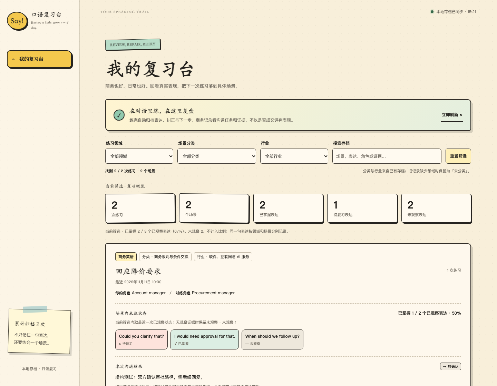
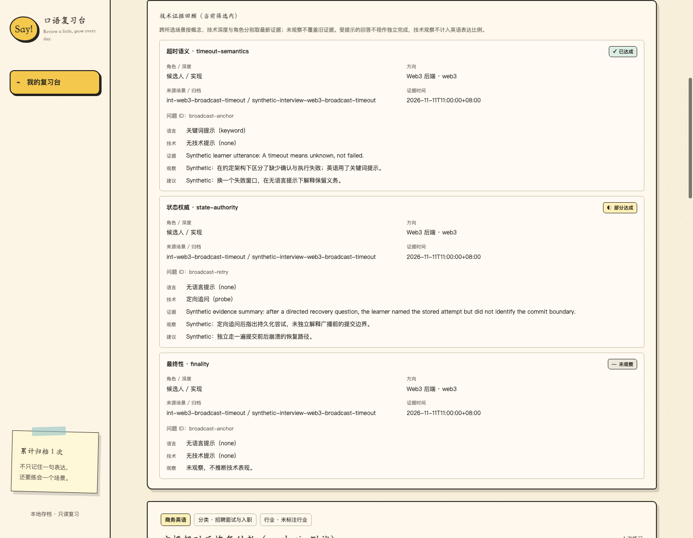

# 口语练习台（Kouyu）

面向 **Codex / Claude Code 等能读取本地 Skill、执行脚本的客户端**的英语口语陪练。日常口语与商务训练共用一条闭环：**选场景 → 预习 → 角色扮演 → 证据反馈 → 本地归档 → 复练**。



截图使用明确标注的虚构测试记录，不代表真实学习者表现。

## Go / Web3 专业英语面试



[查看手机窄屏验收截图](docs/screenshots/interview-mobile.png)。截图中的发言与结果全部是 synthetic 测试数据，不代表你的真实表现。

在原有招聘面试入口下新增 **6 条主线、18 个精选技术面试场景**：交易业务与架构、撮合订单与账本、衍生品风险、行情流动性、Web3 链上交互、Go 工程可靠性。[浏览专业目录](curriculum/interview/catalog.md)。定位是 Go 后端 / 交易系统及 Web3 后端，不宣称覆盖所有 Web3 岗位；Solana 和预测市场暂不作为必修。

- **英语水平与技术深度分开**：英语入门也可练系统设计，英语高级也可补技术基础。
- **候选人 / 面试官双向角色**：一问一答，追问接住实际回答；面试官模式评价学习者的提问与诊断，不把模拟候选人的答案算成学习者能力。
- **安全预习、教师资料显式加载**：默认只显示公开简报；完整参考答案、分支追问和技术标准需 `--coach`。这是教学分隔，不是本地文件保密机制。
- **语言与技术帮助分开记证据**：语言支架、定向技术追问、技术提示和完整解答不会混算独立掌握。
- **双层反馈与知识点复练**：技术观察独立于英语表达状态，跨场景按知识点 + 技术深度 + 角色保留最近已观察证据；不生成综合能力分或录用结论。
- **安装后自包含**：运行时精选题卡依据用户提供的本地 web3-go 资料改编，保留来源映射，但不需要原始题库目录、联网检索或模型 API。源资料未经全量技术审计，教学模型不等于生产方案保证。

在加载 Kouyu 的客户端中说：

```text
用 kouyu 练 20 分钟 Go / Web3 后端面试。
主题：链上交易广播超时与恢复。
英语：中级；技术深度：系统设计；辅助：沉浸式；压力：适中。
我当候选人，你当技术面试官。先给预习卡，不提前给解题答案。
```

也可以指定 `int-web3-broadcast-timeout`。技术深度使用 `foundation`（概念基础）、`implementation`（工程实现）、`system`（系统设计）；压力为 `low / moderate / high`；英语等级和三种提示模式不变。完整流程见 [技术面试协议](references/technical-interview.md)。

```bash
python scripts/interview.py tracks
python scripts/interview.py list --track web3 --limit 6
python scripts/interview.py list --search 广播
python scripts/interview.py show int-web3-broadcast-timeout --level intermediate --depth system --duration 20
# 陪练内部显式读取教师资料；不要在预习中展示输出里的 coach_only
python scripts/interview.py show int-web3-broadcast-timeout --depth system --coach
python scripts/interview.py show int-web3-broadcast-timeout --role interviewer --depth implementation --coach
python scripts/interview.py review --concept timeout-semantics
python scripts/interview.py validate
```

`review` 只读已有归档，缺少档案时不会创建目录。使用自定义数据目录时同样传 `--data-dir`。复练建议基于已有证据，不是自动间隔复习调度器；旧会话不会被补造技术标签。网页仍只做复盘，不是在线答题或代码运行平台。

## 原有商务升级

- **28 个业务大类、168 个原创基础场景**：从商务社交、销售、报价谈判，到会议、项目、采购、财务、招聘、管理、战略和跨境贸易。[浏览完整目录](curriculum/business/catalog.md)
- **12 个行业补充包**：软件与 AI、制造、外贸、零售、咨询、金融、医疗、物流、工程、能源、教育、酒店会展。
- **双向角色**：可以练客户经理，也可以练采购方；可以练应聘者，也可以练面试官。双方有独立目标、信息差与授权边界。
- **三级英语难度、三种辅助模式**：难度改变表达复杂度，辅助模式改变提示时机；商务责任不会因英语入门而消失。
- **商务反馈**：区分沟通结果与语言掌握，观察清晰度、语气、澄清回应、授权边界、收尾行动；拒绝或延期不自动视为失败。
- **复习台升级**：领域 / 类别 / 行业筛选和文字检索，展示业务结果、任务证据及商务反馈，保留纸张卡片风格。
- **旧记录兼容**：历史记录不改写，缺少领域的显示“未分类”；表达掌握度按场景区分，未观察不计入已评估分母。

场景库不是 168 篇背诵对话，也不承诺穷尽所有工作情况。特殊目标可以按同一结构生成自定义场景。内容属于**已定义的模拟练习材料**；结构测试通过不等于真实教学效果或行业认证。

## 原有能力继续保留

- 超市、健身房、咖啡店、餐厅、酒店、机场、理发等日常场景和自定义主题。
- 5 / 10 / 20 / 40 分钟及自定义时长；单词、词组和完整句型分开预习。
- 对应四档时长提供 15 / 20 / 30 / 40 个识别词汇，主动练习目标保持少而精。
- 逐级帮助：中文意图 → 英文关键词或句型 → 完整示范。
- 轻量纠错，区分独立使用、提示后使用和模仿使用；不把“看过”算成掌握。
- JSON 原始记录、Markdown 复习台和本地网页；英语外部材料遵守独立来源与授权范围。

## 安装

需要 **Python 3.10+**（仅标准库，无需 pip / Node.js / 模型 API Key）及能读取 Skill、执行本地脚本的客户端。Git 仅在克隆或更新仓库时需要。浏览器只查看归档，不直接发起 AI 对话或语音通话；实际语音输入、音频可用性取决于使用的客户端。

### Codex

```bash
git clone https://github.com/maverickgao8848/kouyu.git ~/.codex/skills/kouyu
```

### Claude Code

将**这份升级后目录的完整内容**放到 `~/.claude/skills/kouyu/`，保持 `SKILL.md` 位于该目录根部。重新打开会话后使用 `/kouyu` 或明确请客户端读取该 Skill。项目内安装也可使用 `.claude/skills/kouyu/`。

Windows 对应目录位于用户主目录，例如 `$env:USERPROFILE/.claude/skills/kouyu`。命令中的 `python` 不存在时，macOS 可换成 `python3`，Windows 可换成 `py -3`。

> 克隆上游地址得到的是上游当前版本，不会自动包含尚未发布的本地升级。安装本次修改请复制本目录或使用本地打包结果。不要覆盖其他同名 Skill；先检查并备份目标目录。已有 Git 安装只有在相应升级已进入远端后，才通过 `git pull --ff-only` 更新。

## 开始练习

### 商务训练

在已加载 Kouyu 的客户端中说：

```text
使用 kouyu 帮我练一次 20 分钟商务英语。
场景：客户要求降价，我需要说明条件并争取下一步。
行业：软件服务
我的角色：客户经理
程度：中级
辅助：引导式
```

切换角色：

```text
这次我当采购负责人，你当供应商。
我想练习：澄清报价、提出条件、避免未经审批的承诺。
```

具体场景也可直接指定：

```text
练习 biz-delivery-01，20 分钟，中级、沉浸式。
我负责向客户解释项目延期，并重新确认交付计划。
```

特殊需求：

```text
帮我设计一个自定义商务场景：和海外经销商讨论区域独家合作，
但我不能接受无限期排他。先给预习卡，准备好再开始。
```

### 日常训练

```text
使用 kouyu 做一次 10 分钟英语口语训练。
主题：在国外理发；程度：入门；辅助：学习式。
```

Codex 可用 `$kouyu`，Claude Code 可用 `/kouyu`。普通网页聊天不能仅凭这些文字读取本机文件。

预习后说 **“I'm ready.”** 开始；明确说 **“结束练习”** 或 **“Let's wrap up.”** 进入报告。场景中的“结束会议”不应误判为结束训练。

## 查看与检索商务材料

以下命令在本目录运行；从其他目录运行时使用脚本的绝对路径：

```bash
python scripts/business.py categories
python scripts/business.py list --search 报价 --limit 6
python scripts/business.py list --category negotiation
python scripts/business.py industries
python scripts/business.py show biz-negotiation-01 --role b --industry software --level intermediate --duration 20
python scripts/business.py validate
```

`show` 是给陪练读取的结构化简报，包含对手信息；不会自动开始对话。预习时陪练只展示公开背景和学习者自己的信息。检索采用字面匹配，没有结果可换关键词或查类别，不需要联网或向量数据库。

## 本地复习台

```bash
python scripts/workbench.py serve
```

默认 **http://127.0.0.1:8765/**；保持终端运行，`Ctrl+C` 停止。主题和角色在对话中确定，网页只负责复习；每 8 秒检查更新，也可手动刷新。

数据默认保存在用户主目录的 **`english-speaking-workbench`**，与当前工作目录无关。

```bash
python scripts/workbench.py init
python scripts/workbench.py archive --input path/to/session.json
python scripts/workbench.py serve --port 8766 --no-open
```

练习结束后由 Skill 根据真实对话执行归档，无需自己维护 JSON。数据规范见 [workbench-data.md](references/workbench-data.md)。更换数据目录时，给归档和服务传入同一个 `--data-dir`。

- 版本 1 存档可读取，保存时仅将容器版本升级为 2；不补写历史商务标签或学习证据。
- 同一 ID 的相同归档可重复执行；不同内容会拒绝覆盖。
- 相同表达跨场景不合并掌握度；新一次“未观察”不抹掉此前已观察的证据。
- 并发进程归档尚无跨进程锁，请按顺序归档，不要同时启动多个写入任务。
- 数据备份复制整个存档目录；未来版本数据不强行降级。

### 常见问题

- 页面不能打开：确认 Python 仍在运行；换 `--port 8766` 排除端口占用。
- 没有自动弹浏览器：手动打开终端地址，或使用 `--no-open`。
- 无法读取存档：使用 HTTP 服务地址，不能直接双击 HTML；确认归档和服务的数据目录一致。
- 未出现商业分类：旧数据本来没有领域字段，会显示“未分类”，不是数据丢失。
- 没有发音反馈：只有文字或转写不能作为发音证据；没有可听音频时必须标记未观察。

## 开发与验证

运行时无第三方依赖。自动化测试使用 Python 标准库；前端纯函数测试需要 Node.js 18+。可选浏览器验收使用 Node.js 22+ 内置 WebSocket 和本机 Chrome，不安装 npm 包。

```bash
python scripts/business.py validate
python scripts/interview.py validate
python -m unittest discover -s tests -v
node --test tests/frontend.test.cjs
node --check assets/workbench/app.js
node tests/browser_smoke.mjs
python scripts/package.py --output /tmp/kouyu-business.zip
```

打包器只收集 Skill、课程、程序、测试和说明文件，不收集个人存档、缓存或本机设置；同名输出已存在时拒绝覆盖。解压后顶层目录是 `kouyu/`，可放入相应客户端的 Skills 目录。

测试夹具全部标记为虚构，只写临时目录，不读取或修改真实学习存档。浏览器验收会启动并关闭临时 Python 服务与独立 Chrome 配置，截图和虚构数据保留在新建的系统临时目录便于检查；可用 `CHROME_PATH`、`PYTHON` 指定本机程序。新增内容的结构与代码验证，不替代人工教学验证。修改商务场景定义后运行 `python scripts/business.py build-index`；修改专业面试场景后运行 `python scripts/interview.py build-index`。两者分别重建机器索引和人类目录，再执行校验与测试。专业包的安装独立性由解压后、不含 web3-go 原始目录的命令验收覆盖。

## 项目结构

```text
SKILL.md                         # 统一入口，按需路由
agents/openai.yaml               # Codex 客户端元信息
curriculum/business/catalog.md   # 28 类完整场景目录
curriculum/business/index.json   # 轻量检索目录
curriculum/business/scenarios/   # 168 个结构化原创场景
curriculum/business/industries.json # 12 个行业包
curriculum/interview/             # 6 主线 / 18 场景、自包含教师题卡与来源映射
scripts/interview.py              # 专业面试检索、安全简报、教师加载与只读复练
web3-go/                         # 用户原始专业资料（开发源，不进入安装包）
references/                     # 预习、对练、商务反馈和数据规范
scripts/business.py             # 本地检索、单场景加载和全库校验
scripts/workbench.py            # 归档、Markdown 复习台和本地服务
assets/workbench/               # 原生网页复习台
tests/                          # 兼容性、场景完整性和前端测试
TODO.md                         # 升级任务与验收进度
```

## 隐私与边界

本地脚本和网页不会将训练记录上传远端；对话内容如何处理仍取决于所用模型客户端及其设置。不要输入真实密钥、银行资料、患者信息或未脱敏客户文件。使用匿名组织、角色和近似金额。涉及合同、劳动关系、财税、医疗、安全和监管的问题，只练习沟通与专业升级，不替代有资质人士判断。提交或分享前检查不要携带个人 session 文件。
